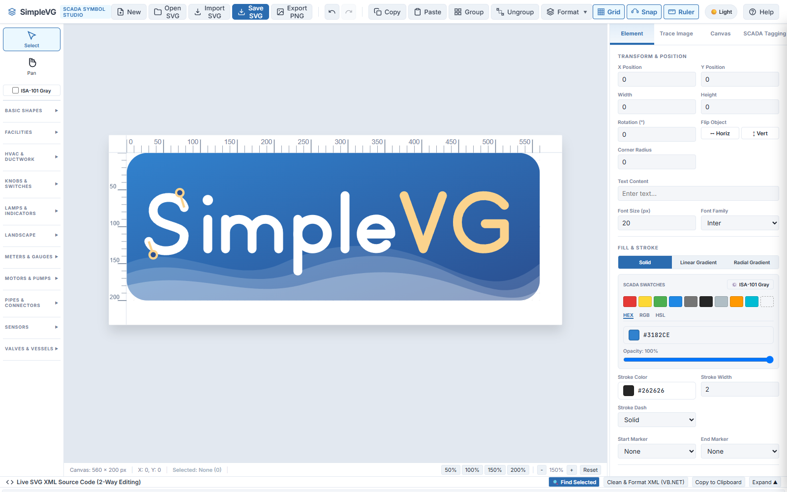

<p align="center">
  
</p>

<p align="center">
  A lightweight, browser-based vector editor for building SCADA / HMI symbols and diagrams.<br>
  Runs locally on a tiny ASP.NET Core server. No database, no accounts, no cloud.
</p>



## Features

- **Vector drawing tools:** rectangles, ellipses, lines, polylines, polygons, stars, arrows, arcs (including a CAD-style 3-point arc), Bézier pen, freehand and text.
- **11 built-in SCADA symbol libraries:** basic shapes, facilities, HVAC and ductwork, knobs and switches, lamps and indicators, landscape, meters and gauges, motors and pumps, pipes and connectors, sensors, valves and vessels. They are meant as a starting point for your own graphics.
- **ISA-101 gray mode:** one click to apply ISA-101 style gray HMI palettes to library symbols.
- **Live two-way SVG/XML editor:** edit the source and the canvas updates, and vice versa. Includes *Find Selected* to highlight the code for the selected object.
- **Reference image tracing:** drop in a sketch or photo as a locked backdrop and trace over it. It is left out of exports by default.
- **Precision tools:** grid and snapping, rulers, arrow-key nudging, align, z-order, flip and mirror, radial array, join paths, grouping, undo and redo.
- **Inspector:** position, size, rotation, gradients, stroke, dash, markers, text styling and SCADA tag metadata.
- **Import and export:** open and save plain SVG, import SVG into the current drawing (with an AI-output sanitizer for common namespace mistakes), and export high-resolution PNG or selection-only SVG/PNG.
- **Built-in help:** press `F1` in the app for the full guide.
- **Tutorials:** step-by-step guides are available at <https://arizona.xml-control.com/simplevg/>.

## Quick start

**Requirements:** the [.NET 10 SDK](https://dotnet.microsoft.com/download). Any modern browser.

```bash
git clone https://github.com/xml-control/SimpleVG.git
cd SimpleVG
dotnet run
```

Then open <http://localhost:5123>.

To use a different port:

```bash
dotnet run -- --Port=8080
```

The port can also be set with a `Port` environment variable or in `appsettings.json`. See [Server & Port Configuration](wwwroot/help/Server_Port_Configuration.md).

> **Note:** the page loads the Inter and JetBrains Mono fonts from Google Fonts. Offline, the editor still works and falls back to system fonts.

## Keyboard shortcuts (highlights)

| Key | Action |
| --- | --- |
| `V` `R` `C` `L` `P` `A` `B` `T` | Select, rectangle, circle, line, polyline, arc, Bézier pen, text |
| `Ctrl+Z` / `Ctrl+Y` | Undo / redo |
| `Ctrl+G` / `Ctrl+Shift+G` | Group / ungroup |
| `Ctrl+J` | Join paths |
| `Ctrl+Shift+F` | Find selected element in the XML source |
| `Arrow keys` | Nudge 1px (`Shift` = 10px) |

The full list is in [Keyboard Shortcuts](wwwroot/help/Keyboard_Shortcuts.md).

## Project layout

```
SimpleVG/
├── Program.vb              # Web host, static files, port configuration
├── Controllers/            # SvgController: XML clean/format and file download endpoints
├── appsettings.json        # Default port and logging
├── wwwroot/
│   ├── index.html          # Editor UI
│   ├── css/                # Styles
│   ├── js/                 # Canvas, tools, inspector, exporter, color picker, help viewer
│   └── help/               # In-app help pages (Markdown)
└── branding/               # Logos and screenshots
```

The editor itself is plain HTML, CSS and JavaScript with no build step and no third-party libraries. The .NET server serves the files and provides two small helper endpoints.

## Contributing

Bug reports and pull requests are welcome. See [CONTRIBUTING.md](CONTRIBUTING.md).

## License

[MIT](LICENSE) © 2026 Stephen Torrance. The SimpleVG name and logo artwork in `branding/` are the project's own; please don't use them to imply endorsement of a fork.

Contact: info@xml-control.com
